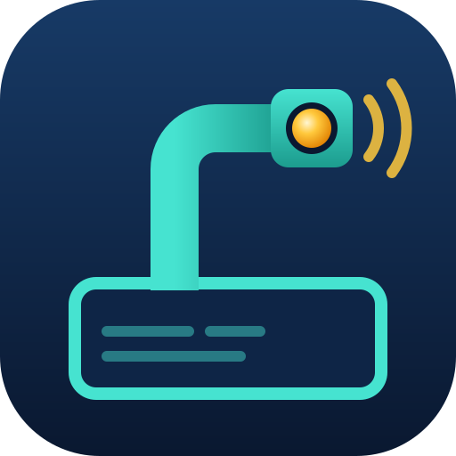
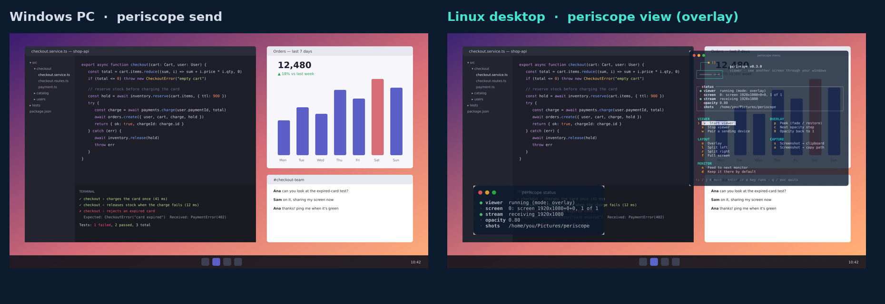
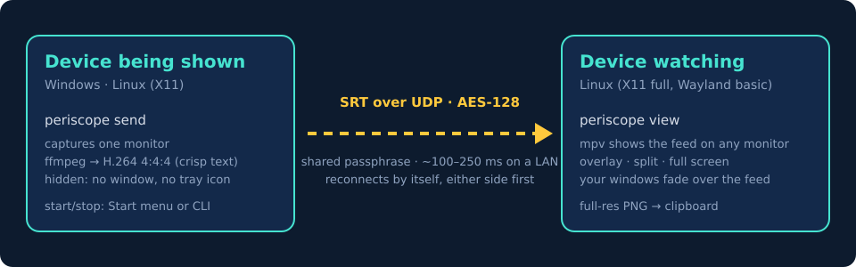
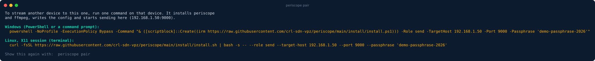
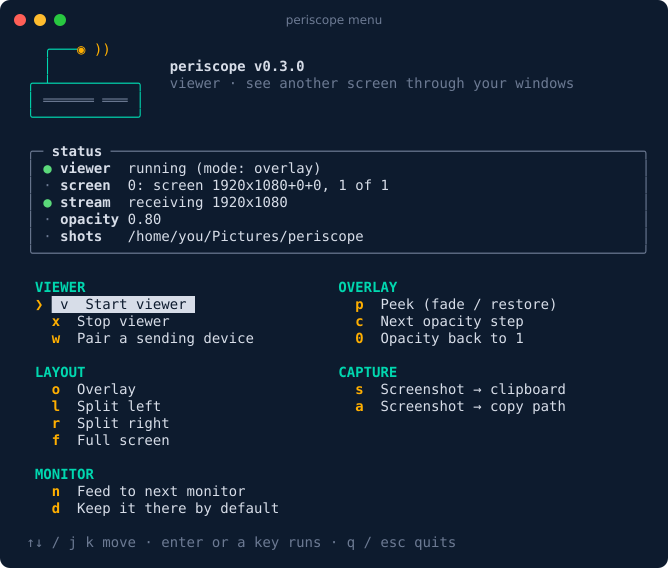
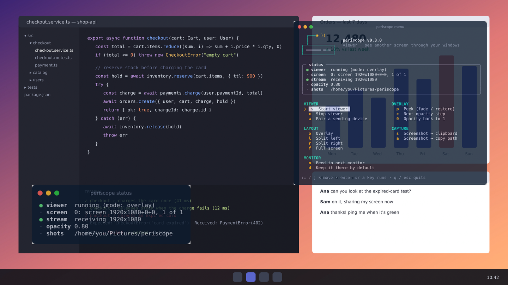
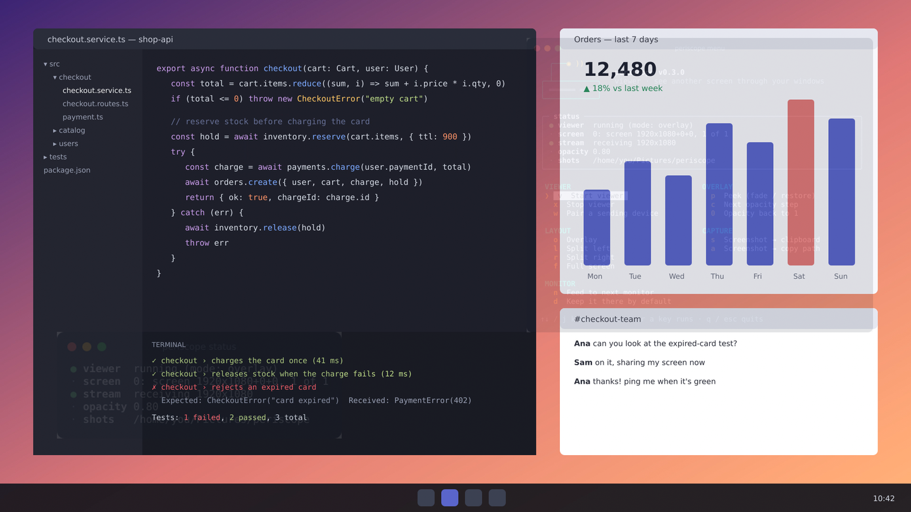
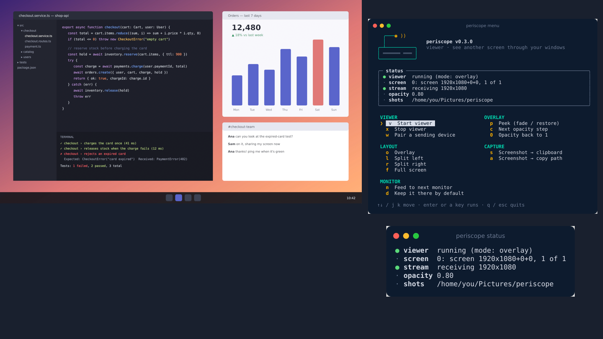
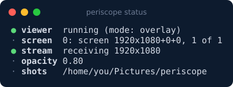

<p align="center">
  
</p>

<h1 align="center">Periscope</h1>

<p align="center">
  <b>See another computer's screen through your own windows.</b><br>
  Low-latency, encrypted screen streaming on your local network, with an overlay mode that keeps<br>
  the other screen behind your work and full-resolution screenshots straight to your clipboard.
</p>

<p align="center">
  <a href="https://github.com/crl-sdn-vpz/periscope/actions/workflows/ci.yml"></a>
  
  
  <a href="LICENSE"></a>
</p>

<p align="center">
  
</p>

Periscope streams one monitor of a computer to another on your network, and shows it **behind your
own windows**. Your apps turn translucent over the feed, so the other screen stays in view while you
keep working, with no extra monitor and no window juggling. One key grabs a pixel-perfect PNG of
the other screen for a bug report, your docs or an AI assistant.

- **Readable:** H.264 with full 4:4:4 color, so small, colored text (code, terminals, logs) stays sharp.
- **Fast:** about 100–250 ms end to end on a LAN.
- **Private:** encrypted with a shared passphrase. No cloud, no accounts, no telemetry.
- **Out of the way:** the sending computer shows no window, taskbar button or tray icon, and only
  runs when you start it.
- **Keyboard-first:** a terminal menu, global hotkeys and app launchers.
- **One command per computer** to install, and `periscope pair` writes the second command for you.

## Contents

[Use cases](#use-cases) · [How it works](#how-it-works) · [Install](#install) ·
[Using it](#using-it) · [Configuration](#configuration) · [Security and privacy](#security-and-privacy) ·
[Troubleshooting](#troubleshooting) · [FAQ](#faq) · [Uninstall](#uninstall) · [Roadmap](#roadmap) ·
[Development](#development)

## Use cases

| | |
|---|---|
| **Follow a pairing or screen-share on a second machine** | Watch a colleague's session (or your own work laptop) behind your editor, and capture frames of what they show without asking them to share again. |
| **Keep an eye on long-running work** | A build, a test run, a render or a training job on another PC stays visible behind your windows; peek when you need a closer look. |
| **Screenshots for bug reports, docs and AI assistants** | `periscope shot` copies the *source-resolution* frame of the other screen to your clipboard, ready to paste into an issue, a wiki or a chat with an assistant. |
| **Develop on Linux, check the Windows build** | Run your app on a Windows box and see it from your Linux workstation; capture exact frames of rendering bugs. |
| **Use a second computer as a heads-up display** | Dashboards, monitoring or a kiosk screen as a translucent layer on one of your monitors, or side by side in split mode. |
| **Demos, classes and labs** | Show a lab machine or a test device on the presenter's laptop, with your notes on top. |

> Periscope is a viewer: it never sends keyboard or mouse input to the other computer. Use it on
> computers you own or have permission to watch, and tell the people in a shared session that you
> follow it from a second machine. See [Security and privacy](#security-and-privacy).

## How it works

<p align="center">
  
</p>

The computer being shown runs `periscope send`, which captures one monitor and streams it over
[SRT](https://github.com/Haivision/srt), encrypted with a shared passphrase. The watching computer
runs `periscope view`, which listens for the stream and shows it with [mpv](https://mpv.io). Either
side can start first; both reconnect on their own. Periscope itself is a single small binary that
drives [ffmpeg](https://ffmpeg.org) and mpv.

| | Send (be watched) | View (watch) |
|---|---|---|
| **Windows 10 21H2+ / 11** | ✅ | planned |
| **Linux, X11 session** | ✅ | ✅ all features |
| **Linux, Wayland session** | planned | ✅ streaming and screenshots; overlay opacity and window placement need X11 |
| **macOS** | planned | planned |

## Install

Both computers must be on the same network. Install the **viewer** first; it prints the command for
the other computer.

### 1. The watching computer (Linux)

```bash
curl -fsSL https://raw.githubusercontent.com/crl-sdn-vpz/periscope/main/install/install.sh | bash
```

This installs `periscope` to `~/.local/bin`, plus mpv and the X11 helpers from your package manager
(it asks for `sudo`). It also creates a config with a random passphrase, opens the UDP port if `ufw`
or `firewalld` is active, adds app launchers, offers GNOME hotkeys and starts the viewer. Last, it
prints the command for the other computer:

<p align="center"></p>

Lost it? `periscope pair` prints it again.

### 2. The computer being shown

- **Windows:** open **PowerShell** (as your normal user, not as administrator), paste the Windows
  line and press Enter. It installs periscope and ffmpeg (through winget), adds a **Periscope**
  folder to the Start menu and starts the sender. Then close PowerShell; it isn't needed again.
- **Linux (X11):** paste the Linux line into a terminal.

Within a few seconds the viewer shows the other screen.

Both installers verify the download against the release's `SHA256SUMS`. To pin a version, add
`--version v0.3.0` (Linux) or `-Version v0.3.0` (Windows). Running the command again updates
periscope and keeps your settings.

<details>
<summary>Build from source instead</summary>

You need Go 1.26+ (the `go` command fetches the exact version from `go.mod`) and
[just](https://github.com/casey/just): `just build` gives you `bin/periscope`.
At runtime the viewer needs `mpv` (with SRT support), `wmctrl`, `xdotool`, `xprop` and `xrandr`, plus
`xclip` or `wl-clipboard`. The sender needs `ffmpeg` (with libsrt). Then run `periscope config init`
on the viewer, and `periscope config init --target-host <viewer-ip> --passphrase <same passphrase>`
on the sender.
</details>

## Using it

### On the watching computer (Linux)

`periscope menu` is the control center: arrows or j/k and Enter, or one key per action.

<p align="center"></p>

Three layouts:

| Overlay (default) | Peek | Split |
|---|---|---|
|  |  |  |
| The feed fills a monitor, behind everything. Your windows on that monitor turn translucent. | One key fades them almost away to read the feed, and again brings them back. | The feed takes part of a monitor (60% by default), and your windows stay solid next to it. |

There is also **full screen**, with the feed on top of everything. With several monitors, pick the
monitor the feed uses: `periscope screens` lists them and `periscope screen next` moves the feed.

#### Shortcuts and commands

| To | Hotkey (GNOME, after `periscope bind-gnome`) | Command · menu key |
|---|---|---|
| Start or stop the viewer | **Super+Shift+V** | `periscope toggle` · app grid: *Periscope: start or stop viewer* |
| Open the control menu | | `periscope menu` · app grid: *Periscope menu* |
| Uninstall | | `periscope uninstall` · app grid: *Periscope: uninstall* |
| Screenshot → clipboard (image) | **Super+Shift+S** | `periscope shot` · `s` |
| Screenshot → clipboard (file path) | **Super+Shift+A** | `periscope shot --path` · `a` |
| Peek | **Super+Shift+P** | `periscope peek` · `p` |
| Next layout | **Super+Shift+M** | `periscope mode overlay\|split-left\|split-right\|full` · `o` `l` `r` `f` |
| Next overlay opacity (0.90 → 0.75 → 0.55 → 0.35) | **Super+Shift+O** | `periscope opacity <0-1\|cycle\|reset>` · `c` `0` |
| Feed to the next monitor | **Super+Shift+N** | `periscope screen <n\|next> [--default]` · `n` `d` |
| Status | | `periscope status` |

Change the hotkeys in GNOME Settings → Keyboard → Keyboard Shortcuts → Custom Shortcuts (they are
named `periscope: …`). On other desktops, bind the commands to keys of your choice.

<p align="center"></p>

Screenshots are saved to `~/Pictures/periscope/` (`latest.png` always points at the newest) at the
other screen's full resolution, whatever the size of the feed on your screen.

### On the computer being shown (Windows)

Nothing runs until you start it, and nothing shows while it runs. Open the Start menu, type
**Periscope**, and use:

| Start menu entry | Does |
|---|---|
| **Periscope - Start sender** | starts streaming (hidden) |
| **Periscope - Stop sender** | stops it |
| **Periscope - Start or stop sender** | one entry for both |
| **Periscope - Status** | opens a small window: `streaming to …`, `waiting for the viewer …` or `the sender is not running` |
| **Periscope - Uninstall** | removes periscope (asks first; see [Uninstall](#uninstall)) |

Right-click an entry → **Pin to Start** or **Pin to taskbar** to keep it at hand. To give one a
hotkey: right-click → *Open file location* → *Properties* → *Shortcut key*. In a terminal it's the
same: `periscope send start | stop | toggle | status`.

On a Linux sender: `periscope send --detach` to start, `periscope send stop` to stop.

## Configuration

Each computer has one JSON file: `~/.config/periscope/config.json` on Linux,
`%APPDATA%\periscope\config.json` on Windows. Read and change it with
`periscope config show | get <key> | set <key> <value>`. Restart the role after a change
(`periscope stop` + `periscope view`, or Stop + Start on Windows).

| Key | Default | Meaning |
|---|---|---|
| `port` | `9000` | UDP port. Same on both sides. |
| `passphrase` | random | 10–79 characters. Same on both sides. |
| `latency_ms` | `80` | SRT buffer. Raise to 200+ on Wi-Fi if the picture stutters (both sides). |
| `send.target_host` | | The viewer's LAN IP. |
| `send.monitor` | `0` | Which monitor to send (0 = primary). |
| `send.fps` | `30` | Frames per second. |
| `send.encoder` | `x264` | `x264` (CPU, sharpest), `nvenc` (NVIDIA), `qsv` (Intel), `amf` (AMD). |
| `send.quality` | `18` | Lower = sharper and more bandwidth; 16–20 keeps text crisp. |
| `send.chroma444` | `true` | Full color resolution for colored text (x264 and nvenc). |
| `send.max_width` | `0` | Downscale wider screens, e.g. `1920` for a 4K monitor. `0` = native. |
| `send.capture` | `auto` | `ddagrab` (Windows), `gdigrab` (Windows fallback), `x11grab` (Linux), `test` (a test pattern). |
| `view.screen` | `0` | Monitor for the feed (`periscope screens`). |
| `view.default_mode` | `overlay` | `overlay`, `split-left`, `split-right` or `full`. |
| `view.overlay_opacity` | `0.80` | Opacity of your windows over the feed. |
| `view.peek_opacity` | `0.12` | Opacity while peeking. |
| `view.opacity_steps` | `0.90,0.75,0.55,0.35` | Steps for "next opacity". |
| `view.split_ratio` | `0.60` | Share of the monitor the feed takes in split mode. |
| `view.overlay_exclude` | `kitty\|Alacritty\|wezterm` | Windows (regex on WM_CLASS) never faded, e.g. terminals with their own transparency. |
| `view.overlay_include` | | If set, only these windows are faded. |
| `view.shot_dir` | `~/Pictures/periscope` | Where screenshots go. |

Tip for terminals: give them background-only transparency (kitty: `background_opacity 0.55`) and
leave them in `overlay_exclude`. The feed shows through while the text stays fully sharp.

## Security and privacy

- **Encrypted:** the stream uses SRT's built-in AES-128 encryption, keyed from the shared
  passphrase, and encryption is enforced: a sender with a wrong or missing passphrase is refused.
- **Local:** periscope talks directly between your two computers. No relay, cloud service, account
  or telemetry.
- **Only your network:** the installer opens the viewer's UDP port for the local subnet only, so a
  laptop that joins a café's Wi-Fi isn't reachable from it.
- **Keep the passphrase private:** the config file is readable only by your user, logs never contain
  it, and the viewer keeps it off the process list. Anyone with the passphrase who can reach the
  viewer's port can show it a picture; nobody can make the viewer send anything.
- **Verified downloads:** the installers check the binary and the icons against the release's
  `SHA256SUMS`. Builds use a supported Go version and are scanned with `govulncheck`.
- **View only:** the viewer never controls the other computer. Screenshots are taken only when you
  ask, and stay on your disk.
- **Be open about it:** the sender is quiet so it doesn't clutter a screen that people are looking
  at, not so it can hide. Only watch computers you own or have permission to watch, follow your
  workplace's policies, and let the people in a shared session know you follow it from a second
  machine.

The threat model, the known limits (for example, a Linux sender's passphrase is visible to other
local users in the process list) and how to report a vulnerability are in [SECURITY.md](SECURITY.md).

## Troubleshooting

| Problem | Try |
|---|---|
| The viewer stays on `waiting for the sender` | On Windows, run **Periscope - Status**. Check that both sides have the same passphrase and port (`periscope config get passphrase`), that `send.target_host` is the viewer's current IP, and that UDP 9000 is open on the viewer (`sudo ufw allow 9000/udp`). `periscope logs send` on the sender shows the last errors. |
| The picture stutters on Wi-Fi | `periscope config set latency_ms 200` on both sides, or use Ethernet. |
| High CPU on the sender | `send.encoder nvenc` / `qsv` / `amf`, a lower `send.fps`, or `send.max_width 1920`. |
| Opacity/peek seem to do nothing | `periscope windows` lists every window and whether it is faded, solid (on another monitor) or skipped (and why). Fading works in overlay mode, on the feed's monitor. |
| Windows stay translucent | `periscope stop` makes them solid again, even after a crash. |
| Overlay and split do nothing | You're on Wayland: log into the "on Xorg" session for those. |
| `ddagrab` errors on Windows | Update ffmpeg (`winget upgrade Gyan.FFmpeg`) or `periscope config set send.capture gdigrab`. |
| Windows Defender or SmartScreen warns about `periscope.exe` | Releases aren't code-signed yet. Check the download against `SHA256SUMS` (the installer does), or build it yourself. |

Logs: `periscope logs view|mpv|send|ffmpeg [-f]`.

## FAQ

**Does it work over the internet?** It's built and tested for a local network. SRT can cross the
internet with a forwarded UDP port, but that isn't supported yet.

**How is this different from VNC or RDP?** Those let you *control* another computer. Periscope only
*shows* it, with video-grade latency, behind your own windows, and with frame-exact screenshots.

**Audio?** No, video only.

**Can I watch several computers?** One at a time for now; multiple sources are on the roadmap.

**Does the other computer's user see anything?** No window, tray icon or taskbar button: the sender
shows up only in Task Manager. See [Security and privacy](#security-and-privacy) for using that
responsibly.

## Uninstall

One click or one command on each computer. It lists what it will remove and asks before it does
anything:

| | One click | One command |
|---|---|---|
| **Linux** | app grid → **Periscope: uninstall** | `periscope uninstall` |
| **Windows** | Start menu → **Periscope - Uninstall** | `periscope uninstall` (in PowerShell or a command prompt) |

It stops periscope (your windows go back to solid), then removes the program, its config and
passphrase, logs, launchers or Start menu entries, the icon, the GNOME hotkeys and the `PATH` entry.
`--keep-config` keeps your settings for a later reinstall, and `--yes` skips the question (for
scripts).

It leaves alone what other software may use: mpv and ffmpeg (remove them with your package manager,
or `winget uninstall Gyan.FFmpeg`) and the firewall rule (`sudo ufw delete allow 9000/udp`).

<details>
<summary>By hand, if the <code>periscope</code> command is already gone</summary>

- **Linux:** remove `~/.local/bin/periscope`, `~/.config/periscope`,
  `~/.local/share/applications/periscope-*.desktop` and
  `~/.local/share/icons/hicolor/256x256/apps/periscope.png`, and the `periscope: …` entries in
  GNOME Settings → Keyboard → Custom Shortcuts.
- **Windows:** end `periscope.exe` in Task Manager, delete `%LOCALAPPDATA%\periscope`,
  `%APPDATA%\periscope` and the Start menu folder *Periscope*, and remove
  `%LOCALAPPDATA%\periscope\bin` from your user `PATH`.
</details>

## Roadmap

- **Remote control of the sender from the viewer** (start/stop, switch monitor, quality), over an
  authenticated channel, and lossless snapshots on demand.
- **More platforms:** view on Windows and macOS, send from macOS, full Wayland support.
- Region screenshots, multiple sources, a capture-card input.

The design is in [docs/adr/0001](docs/adr/0001-go-cross-platform-core.md).

## Development

```bash
just build      # bin/periscope
just check      # lint (gofmt, go vet for linux/windows/darwin, shellcheck), unit tests, end-to-end tests
just dist       # release binaries, icons and SHA256SUMS in dist/
```

The end-to-end tests stream between a real `periscope send` and `periscope view` on a virtual
display (they need `xvfb openbox mpv ffmpeg wmctrl xdotool x11-utils x11-apps xfonts-base xclip`).
CI runs them on Ubuntu, and runs the Windows installer and sender on a Windows runner.
[docs/hardware-test.md](docs/hardware-test.md) covers testing a change on two real computers
before a release. `just icons` and `just screenshots` regenerate the icon files and the images in
this README. Contributor and agent notes are in [CLAUDE.md](CLAUDE.md).

The original bash/PowerShell version is described in [docs/v0.2-scripts.md](docs/v0.2-scripts.md).

## License

[MIT](LICENSE) © 2026 Carlos VP
